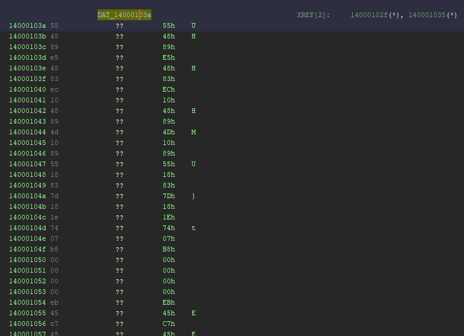
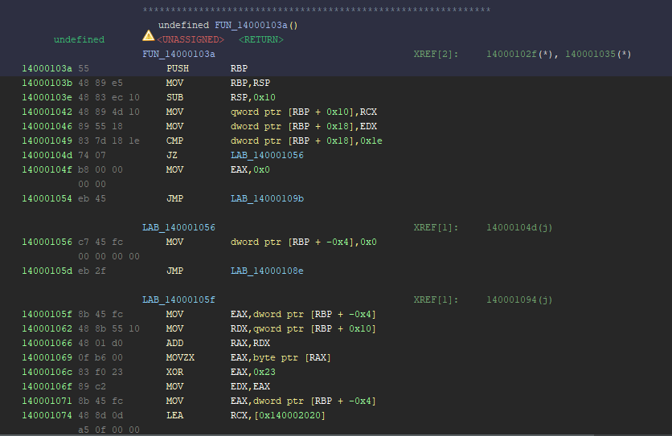

# GhidraSupersetDisassembler (GhidraAmace)

[English](README.md) | **日本語**

Ghidra 12.2向けのx86／x86-64 Superset Disassembly Extensionです。各バイト位置から命令候補を生成し、AMACE論文の後方解析をJava／P-codeで実装します。重なった候補を保持しながら、根拠のある命令と関数を通常のListingへ自動反映します。

[Superset Disassembly（Baumanら、NDSS 2018）](https://personal.utdallas.edu/~hamlen/bauman18ndss.pdf)と[AMACE（Nguyenら、PLDI 2026）](https://doi.org/10.1145/3808292)に基づく独立した実装です。Google Researchが紹介するAMACEの後方解析をGhidraへ適用し、入口候補の生成とListingへ反映する命令の選別には本Extension独自の規則を用います。GoogleやGhidra開発元の公式製品ではありません。

## 動作環境

- Ghidra **12.2**
- Java **25**、ビルド時はGradle **9.1以降**
- x86 **32bit／64bit固定モード**のELF、PE、Raw Binary

解析はGhidra内で完結します。AMACE原実装、Python、Docker、外部ネイティブ解析器は実行時に不要です。

## インストールと実行

1. [GitHub Releases](https://github.com/blend-tea/GhidraSupersetDisassembler/releases)からExtension ZIPを取得します。GhidraのProjectウィンドウで **File → Install Extensions** を開き、そのZIPを追加して再起動します。自分でビルドした場合は`dist/`のZIPを使います。
2. CodeBrowserの **File → Configure → Configure All Plugins** で`AmacePlugin`を有効にします。
3. バイナリを取り込み、通常の **Auto Analyzeは開始せず**、**Tools → AMACE → Analyze and Apply** を実行します。
4. 処理後の **AMACE Superset Candidates** 一覧で、採用／保留理由と解析結果を確認します。列の並べ替え、文字列フィルタ、行のダブルクリックによるListingへの移動が使えます。

ELF／PEは初期化済み実行領域を対象とします。Listingで範囲を選択してから実行すると、その範囲を使います。Raw Binaryでは、取込時に正しいLanguage・Compiler Spec・ベースアドレスを指定し、実行時のダイアログで入口・解析範囲・ABIを指定してください。

### 適用前後の例：未定義領域を命令として認識する

次の画像は、`0x14000103a`から始まる同じ領域の比較です。範囲を限定する場合はListingで対象領域を選択し、**Tools → AMACE → Analyze and Apply**を実行してください。解析終了後、Listingと候補一覧を確認します。

**AMACE適用前：** `DAT_14000103a`の領域が未定義バイト（`??`）として表示されています。



**AMACE適用後：** `FUN_14000103a`が作成され、`PUSH RBP`、`MOV RBP,RSP`、`SUB RSP,0x10`などの命令や、分岐命令と分岐先ラベルが表示されています。採用した候補の反映によって、未定義だった領域を通常のListingで命令列として読めるようになった例です。



## ビルド

```sh
export JAVA_HOME=/path/to/jdk-25
export GHIDRA_INSTALL_DIR=/path/to/ghidra_12.2_PUBLIC
./gradlew clean buildExtension coreTest
```

ZIPは`dist/`へ出力されます。`coreTest`はGhidraに依存しない解析・命令選別の回帰テストを実行します。

## headless実行

ExtensionをインストールしたGhidraから、GUIと同じ解析サービスを呼び出せます。標準解析を開始しないよう、`-noanalysis`を指定します。

```sh
"$GHIDRA_INSTALL_DIR/support/analyzeHeadless" /path/to/projects AmaceDemo \
  -import /path/to/program.elf -noanalysis \
  -scriptPath /path/to/GhidraAmace/ghidra_scripts \
  -postScript RunAmace.java --report /path/to/report.jsonl
```

Raw Binaryでは、`-loader BinaryLoader -processor x86:LE:64:default -loader-baseAddr 100000`等の取込設定に加え、スクリプトへ`--abi SYSV_X64 --entry 100000 --start 100000 --end 100fff`を指定します。アドレスは16進表記、範囲末尾は含みます。`--no-apply`はProgramへ反映せず結果だけを生成します。レポートは先頭行に概要、後続行に全候補と未解決分岐を並べたJSON Lines形式です。

## 解析結果の意味

- Supersetの候補は、指定された命令モードで有効にデコードできた全開始位置を含みます。通常のListingには、その中から競合しない候補を選んで登録します。
- 入口情報、採用済みコードからの直接呼出し、AMACEによる関数開始点の推定の順で採用します。同順位の重複は保留し、短い命令や小さいアドレスを優先して決着させません。
- 未解決の間接分岐、未対応P-code、解析不能なスタック操作はunknownとして残します。unknownだけを根拠に新しい関数や非復帰呼出しを確定しません。
- 既存の競合命令・定義済みデータ・関数名・シグネチャは保持します。新規取込後の使用を基本とし、既存Programを破壊的に再構築する機能は提供しません。
- Listingへの選別は本Extension独自の統合規則です。AMACEの関数開始点推定を、全命令の正しさを証明するものとして扱いません。

操作と制約の詳細は[利用ガイド](docs/usage_ja.md)を参照してください。

## 大きなバイナリとメモリ使用量

全開始位置の命令候補・P-code・解析結果をメモリに保持するため、大きな入力では`OutOfMemoryError: Java heap space`になる場合があります。現版は大規模入力向けの省メモリ化が未実施です。解析範囲を選択して限定するか、利用可能なRAMに合わせて`GHIDRA_MAXMEM`を設定し、Ghidraを再起動してください。headless専用の上限には`GHIDRA_HEADLESS_MAXMEM`も使えます。ヒープの増量だけで全サイズの入力を処理できるという保証はありません。

小さな既知バイト列を用いた検証結果と評価範囲は[検証記録](docs/VALIDATION_ja.md)に記載しています。論文の精度・性能値をこの移植版の測定結果として主張しません。

## 参考文献

- **AMACE**: Huan Nguyen, Soumyakant Priyadarshan, ChenCheng Jiang, R. Sekar. *Analyzing Bytes: Pre-Disassembly Static Binary Analysis*. Proceedings of the ACM on Programming Languages (PLDI), 2026. [DOI: 10.1145/3808292](https://doi.org/10.1145/3808292) / [論文PDF](https://www.seclab.cs.sunysb.edu/seclab/pubs/amace.pdf) / [Google Researchの紹介](https://research.google/pubs/analyzing-bytes-pre-disassembly-static-binary-analysis/) / [著者の研究実装](https://github.com/nhuhuan/amace)
- **Superset Disassembly**: Erik Bauman, Zhiqiang Lin, Kevin W. Hamlen. *Superset Disassembly: Statically Rewriting x86 Binaries Without Heuristics*. NDSS, 2018. [論文PDF](https://personal.utdallas.edu/~hamlen/bauman18ndss.pdf) / [著者のMultiverse実装](https://github.com/utds3lab/multiverse)
- **Ghidra**: [公式リポジトリ](https://github.com/NationalSecurityAgency/ghidra)。SLEIGH、P-code、PseudoDisassemblerおよびExtension APIを利用しています。

本Extensionは論文に基づく独立したJava実装です。研究用C++／OCamlバックエンドは同梱しません。

## ライセンス

本リポジトリの既存の[MIT License](LICENSE)を適用します。Gradle Wrapperの生成ファイルは元のApache-2.0ライセンスを保持し、[ライセンス本文](licenses/Apache-2.0.txt)を同梱しています。Ghidraは別途入手する依存ソフトウェアです。
